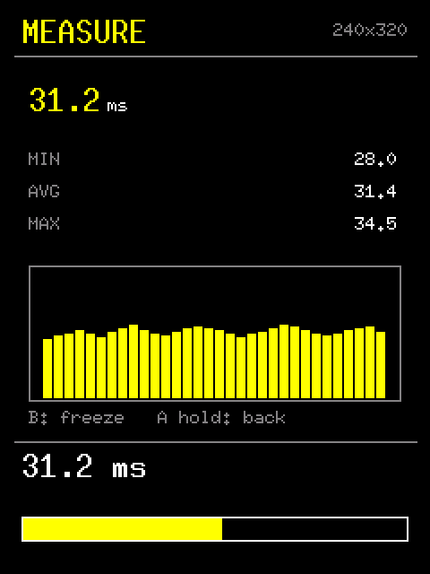
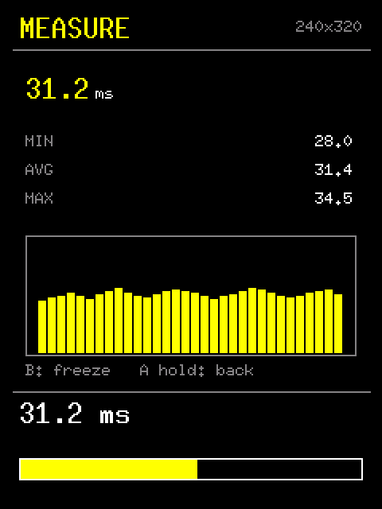
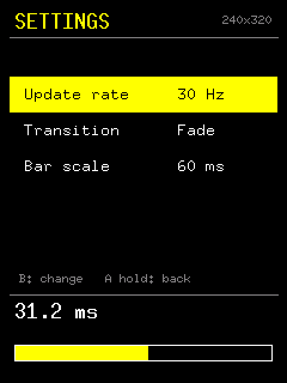
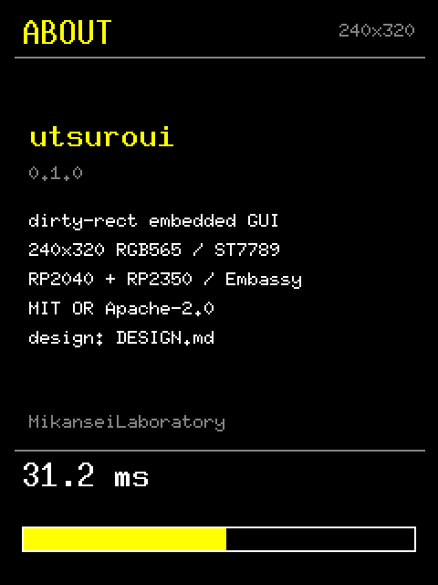
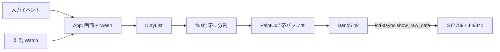

# utsuroui（移ろい）

[](https://github.com/MikanseiLaboratory/utsuroui/actions/workflows/ci.yml)

240×320 RGB565 の SPI TFT（ST7789 / ILI9341）を、RP2040 / RP2350 + Embassy で
dirty-rect 描画するための小さな組込み GUI フレームワーク。

「移ろい」= 変わるものだけを、滑らかに。画面全体を毎フレーム送らず、
**変わった矩形だけ**を帯（ストライプ）に切って送り、アニメーションは
固定小数点の tween で動かす。`no_std` / アロケーションなし。

| Menu | Measure |
|---|---|
|  |  |

| Settings | About |
|---|---|
|  |  |

（画像はすべてホスト上の実描画です。`cargo run -p utsuroui-demo --example render_png` で再生成できます）

## 特徴

- **dirty-rect + 帯転送**: 変化した矩形だけを 16 行の帯に切って `show_raw_data` で送る。
  ハイライト移動 1 回の転送は約 25 KB（全画面 153,600 B の 1/6）。
- **固定小数点 tween**: 位置・数値・アルファ・色を `Tween` 1 種類で補間。
  `retarget` により、ボタン連打でも動きが途切れない。イージングは 257 要素 LUT。
- **静的合成 retained UI**: ウィジェットは記述子、状態は画面と同じ寿命の普通の struct。
  ヒープも `dyn Widget` も描画ツリー 2 本も持たない。
- **2 ボタン前提のフォーカス**: 起動直後から index 0。`Next` / `Select` / 長押し `Back`。
  ロータリーエンコーダの直交デコードとタッチの hit test も同梱。
- **画面ルータと遷移**: `enum` 画面の固定長スタック。カット / 黒経由フェード /
  横スライド / クロスフェード。遷移中の Back は「打ち切ってカットで戻る」。
- **Embassy 統合**: `ui_task` が入力・計測 Watch・tween・dirty 集約・帯転送・
  フレームペースを回す。静止時は SPI を止める（0 fps）。
- **計測の隔離**: 計測は core 1 の bare loop が最新値だけを `Watch` に書く。
  UI はその値を 30 Hz に間引いて表示する（DESIGN.md §12）。
- **ホストで同じ描画**: `MemorySink` で本番と同じパイプラインを通し、
  PNG ゴールデン画像 8 枚と RGB565 バイト順を CI で固定。
- **実測サイズ**（`--release`, defmt 込み）:
  RP2040 = Flash 約 50 KB / RAM 約 21 KB、RP2350 = Flash 約 51 KB / RAM 約 21 KB。

## 構成

```text
utsuroui/
├── crates/utsuroui/        # コア（no_std, no-alloc, forbid(unsafe_code)）
│   ├── geom / color / dirty / anim / text / event / focus / input
│   ├── paint / band / flush / app           # 描画パイプライン
│   ├── widget / nav                          # レイアウト・ルータ・遷移
│   └── lcd (feature) / u8g2 (feature) / embassy_task (feature)
├── crates/utsuroui-demo/   # lagbuster 風デモ（メニュー/計測/設定/About）
│   ├── src/…               # 4 画面 + 遷移 + ライブ数値
│   ├── tests/golden/*.png  # ゴールデン画像
│   └── examples/render_png.rs
├── examples/pico-tft/      # RP2040 / RP2350 ファームウェア
└── docs/                   # DESIGN.md, ARCHITECTURE.md, HARDWARE.md, …
```



## クイックスタート

### ホストでテスト・描画

```sh
cargo test -p utsuroui -p utsuroui-demo      # 127 tests（ゴールデン込み）
cargo run -p utsuroui-demo --example render_png
open target/golden/menu_initial.png
```

### ファームウェア（RP2040 / Pico）

```sh
rustup target add thumbv6m-none-eabi
cargo build -p pico-tft --release --target thumbv6m-none-eabi
# SWD 書き込み（Pico Debug Probe 等）
cd examples/pico-tft && probe-rs run --chip rp2040
```

### ファームウェア（RP2350 / Pico 2）

```sh
rustup target add thumbv8m.main-none-eabihf
cargo build -p pico-tft --release --no-default-features --features rp235xa \
    --target thumbv8m.main-none-eabihf
cd examples/pico-tft && probe-rs run --chip RP235x
```

配線は [docs/HARDWARE.md](docs/HARDWARE.md)。SPI は 31.25 MHz を既定にしてあるが、
**モジュールによって安定上限が違う**ので、必ず実機で確認すること（DESIGN.md §4.7）。

### 自分のアプリを書く

```rust
use utsuroui::{App, DirtyList, Event, PaintCx, Dirty};

struct MyApp { frame: u32 }

impl App for MyApp {
    fn event(&mut self, _event: &Event, _now_us: u64, _dirty: &mut DirtyList) {}
    fn tick(&mut self, _now_us: u64, _dirty: &mut DirtyList) -> bool { false }
    fn paint(&self, cx: &mut PaintCx<'_>, _now_us: u64) {
        cx.fill_rect(utsuroui::SCREEN, utsuroui::BLACK);
        cx.text("hello", utsuroui::Point::new(8, 8), utsuroui::TextStyle::Large, utsuroui::YELLOW);
    }
}

let mut app = MyApp { frame: 0 };
let mut dirty = Dirty::new(utsuroui::SCREEN);
dirty.mark_full();
// ファームウェア側: embassy_task::ui_task(&mut app, &mut display, …).await
let _ = (&mut app, &mut dirty);
```

`App::paint` は「帯に切られた画面の一部」を描く。呼び出し側が dirty に積んだ領域は
必ず塗り切ること（バッファはクリアされない）。座標は常に画面座標で、
クリップと帯への変換は `PaintCx` が行う。

## 状態

- ホスト: 全テスト green（コア 87 + 統合 11 + デモ 28）。ゴールデン画像 8 枚で固定。
- ターゲット: `thumbv6m-none-eabi` / `thumbv8m.main-none-eabihf` の
  `cargo check` とファームウェアのリンクまで CI で確認。
- **実機での動作（SPI 実測・スタック最低水位・フレーム時間）は未検証**。
  手順は [docs/HARDWARE.md](docs/HARDWARE.md) に残してある。

## 設計とドキュメント

- [docs/DESIGN.md](docs/DESIGN.md) — 出発点になった実装設計書（原文）
- [docs/ARCHITECTURE.md](docs/ARCHITECTURE.md) — 層構成・dirty→帯→DMA の流れ・実測サイズ
- [docs/IMPLEMENTATION_PLAN.md](docs/IMPLEMENTATION_PLAN.md) — マイルストーン、決定事項、設計書との差分
- [docs/HARDWARE.md](docs/HARDWARE.md) — 配線、パネル設定、SPI、実測手順
- [docs/FONT-LICENSES.md](docs/FONT-LICENSES.md) — U8g2 フォントのライセンス方針

## ライセンス

MIT OR Apache-2.0（[LICENSE-MIT](LICENSE-MIT) / [LICENSE-APACHE](LICENSE-APACHE)）。

- コアの依存は MIT / MIT OR Apache-2.0 のみ（`embedded-graphics`、`lcd-async`、
  `u8g2-fonts`（任意）、`embassy-*`（任意））。
- `u8g2` feature を有効にする場合、**フォントはクレートとは別ライセンス**。
  デモとファームウェアは `embedded-graphics` 付属フォントだけを使う。
- Buoyant はフォークしていない。参考にしたのは「値が変わったときだけ動かす」
  「途中で付け替えても補間がつながる」といった考え方のみ。

サードパーティの表示は [NOTICE](NOTICE) を参照。
