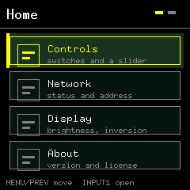

# utsuroui (移ろい)

[](https://github.com/MikanseiLaboratory/utsuroui/actions/workflows/ci.yml)

A small GUI framework for 240x240 SPI TFTs (ST7789 / ILI9341) on Embassy.

It exists for panels with no framebuffer to spare: the screen is painted in 16-row bands and only the rectangles that changed are sent.  
The panel transfer runs while the CPU paints the next band, so a full-width animation stays smooth on an RP2040 without ever allocating a full frame.

- **No framebuffer, no heap, no `unsafe` in the core.**  
  Three 7.5 KiB band buffers replace a 153.6 KiB frame; widgets are values and state is a plain struct.
- **Async, not a render loop.**  
  `ui_task` is an Embassy task, so input never waits for a redraw and an idle screen sends nothing.
- **Animation as data.**  
  Every motion is an integer `Tween` that can be retargeted mid-flight, and animated widgets report their own dirty rectangles.
- **One seam to the hardware.**  
  SPI with DMA, a parallel bus and a memory buffer are all a single `BandSink::write_band`.

| Menu | GUI showcase |
|---|---|
|  |  |

```sh
cargo test -p utsuroui -p utsuroui-demo       # host goldens, invariants
cargo build -p gui-showcase --release --target thumbv6m-none-eabi
```

Start from [examples/gui-showcase](examples/gui-showcase) for a UI, or [examples/pico-tft](examples/pico-tft) for the smallest firmware.  
Wiring and clocks are in [docs/HARDWARE.md](docs/HARDWARE.md), the design in [docs/DESIGN.md](docs/DESIGN.md).

Measured on an RP2040 at 62.5 MHz SPI: 49 KiB per full-width scrolling frame at ~57 fps, ~50 KiB flash and ~25 KiB RAM.

MIT OR Apache-2.0.
