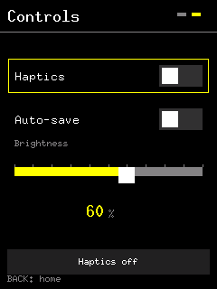

# utsuroui (移ろい)

[](https://github.com/MikanseiLaboratory/utsuroui/actions/workflows/ci.yml)

A tiny, allocation-free GUI for 240x320 RGB565 SPI TFTs (ST7789 / ILI9341) on
any Embassy target, built on `embedded-graphics`.

The core depends only on `embedded-graphics` (drawing) and, for the scheduler,
`embassy-sync` / `embassy-time`; there is no HAL in it. Bring any panel by
implementing `BandSink`, or use the bundled `lcd-async` adapter. The example
firmwares target RP2040 and RP2350 because that is what they were tested on.

Only dirty rectangles are painted and sent, as 16-row bands. Animation is
fixed-point tweening with continuous retargeting.

| Menu | Measure |
|---|---|
|  |  |

| GUI showcase — home | controls |
|---|---|
|  |  |

## Features

- **Dirty-rect bands** — a 16 px highlight move sends ~25 KB, not the 153,600 B
  full frame.
- **Fixed-point tweens** — `Tween::retarget` keeps motion continuous when a
  button is pressed mid-animation; easing is a 257-entry LUT, no soft-float.
- **Retained static UI** — widgets are descriptors, state lives as long as the
  screen. No heap, no `dyn Widget`, no double render tree; the core is
  `#![forbid(unsafe_code)]`.
- **Two-button focus** — starts at index 0; `Next` / `Select` / long-press
  `Back`. Encoder and touch decoding included.
- **Router + transitions** — cut, fade through black, horizontal slide and
  crossfade (crossfade repaints the outgoing screen, so no frame snapshot).
- **Embassy integration** — `ui_task` turns input, `Watch` samples and dirty
  rectangles into bands, then paces frames. Idle means no SPI traffic.
- **Transport-agnostic** — the renderer only knows `BandSink`
  (`write_band(rect, bytes).await`). SPI + DMA live behind it (`lcd-async`
  adapter); a parallel, USB or in-memory sink needs no change to the framework.
- **Pipelined transfer** — the next band is painted while the previous one is
  on the wire: two band buffers and one sink, no extra task, no `'static`.
- **Band buffers included** — `BandBuffers<N>` owns the paint, send and
  crossfade buffers, so firmware does not juggle `split_at_mut`.
- **Animated widgets** — `Highlight`, `Toggle`, `Slider`, `Toast`, `Marquee`
  and `Orbit`. Each one reports the rectangles it invalidated, so an animation
  sends only what moved.
- **Measurement isolation** — core 1 only writes the latest sample; the UI
  throttles it to 30 Hz.
- **Host-tested** — 8 PNG goldens, byte-order and band-splitting checks,
  frame-budget tests, plus `thumbv6m` / `thumbv8m.main` cross-checks.
- **Size** — ~50 KiB flash / ~21 KiB RAM for the demo firmware (release, defmt).

## Workspace

```text
crates/utsuroui/      core: geom/color/dirty/anim/text, paint/band/flush,
                      widgets, router, transitions, Embassy task, lcd-async adapter
crates/utsuroui-demo/ 240x320 demo app, golden tests, PNG screenshot tool
examples/pico-tft/    RP2040 (SPI0) and RP2350 (feature rp235xa)
examples/spi1-panel/  same demo on SPI1 with an 8-key front panel
examples/anim-showcase/ animation demo: waveform, ticker, floating rings, spectrum
examples/gui-showcase/  card list, switches, slider and toast: the widget layer in use
```

## Quick start

```sh
# Host tests and screenshots
cargo test -p utsuroui -p utsuroui-demo
cargo run -p utsuroui-demo --example render_png     # target/golden/*.png

# Generic Pico (RP2040)
rustup target add thumbv6m-none-eabi
cargo build -p pico-tft --release --target thumbv6m-none-eabi

# SPI1 panel + keys, the animation demo and the GUI demo
cargo build -p spi1-panel --release --target thumbv6m-none-eabi
cargo build -p anim-showcase --release --target thumbv6m-none-eabi
cargo build -p gui-showcase --release --target thumbv6m-none-eabi

# Flash (SWD)
cd examples/pico-tft && probe-rs run --chip rp2040
```

RP2350 / Pico 2: `cargo build -p pico-tft --release --no-default-features
--features rp235xa --target thumbv8m.main-none-eabihf`.

Wiring and clock notes: [docs/HARDWARE.md](docs/HARDWARE.md).

## Writing an app

```rust
use utsuroui::{App, Dirty, DirtyList, Event, PaintCx};

struct MyApp;

impl App for MyApp {
    fn event(&mut self, _: &Event, _: u64, _: &mut DirtyList) {}
    fn tick(&mut self, _: u64, _: &mut DirtyList) -> bool { false }
    fn paint(&self, cx: &mut PaintCx<'_>, _: u64) {
        cx.fill_rect(utsuroui::SCREEN, utsuroui::BLACK);
        cx.text("hello", utsuroui::Point::new(8, 8),
                utsuroui::TextStyle::Large, utsuroui::YELLOW);
    }
}

let mut app = MyApp;
let mut dirty = Dirty::new(utsuroui::SCREEN);
dirty.mark_full();
// Firmware: utsuroui::embassy_task::ui_task(&mut app, &mut display, ...)
```

`paint` draws one band of the screen. Everything marked dirty must be fully
covered — the band buffer is not cleared. Coordinates are always screen
coordinates; clipping and band translation are handled by `PaintCx`.

## Status

Host-tested (golden images, band splitting, dirty-rect convergence) and
cross-compiled for RP2040 and RP2350; both demo firmwares run on hardware.
Measured on RP2040 at 62.5 MHz SPI: a full 240x320 band flush takes ~7.9 ms, and
the animation demo holds ~60 fps. SPI clock limits, stack watermark and frame
times per target are in [docs/HARDWARE.md](docs/HARDWARE.md).

## Docs

[docs/DESIGN.md](docs/DESIGN.md) (starting design) ·
[docs/ARCHITECTURE.md](docs/ARCHITECTURE.md) ·
[docs/IMPLEMENTATION_PLAN.md](docs/IMPLEMENTATION_PLAN.md) ·
[docs/HARDWARE.md](docs/HARDWARE.md) ·
[docs/FONT-LICENSES.md](docs/FONT-LICENSES.md)

## License

MIT OR Apache-2.0. Third-party notices: [NOTICE](NOTICE).
