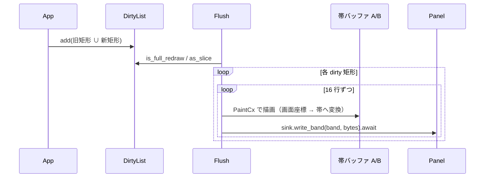

# アーキテクチャ

## 層

```text
アプリ (utsuroui-demo / ファームウェア)
  └── App: 画面 enum + Router + Transition + Tween + DirtyList
utsuroui（no_std, no-alloc）
  ├── widget / nav          : レイアウト、スタック、遷移タイミング
  ├── paint / flush         : 帯バッファへの描画、dirty → 帯 → sink
  ├── band                  : BandSink トレイト、MemorySink、混合
  ├── geom / color / anim / text / dirty / focus / input
  └── lcd / u8g2 / embassy  : 任意 feature のアダプタ
HAL
  └── lcd-async 0.1.3 → embassy-rp SPI DMA → ST7789 / ILI9341
```

ファームウェア example は 2 本ある。どちらも同じコアとデモを使い、変わるのは
パネルのバス・ピンとキーの割り当てだけ（`examples/pico-tft` は SPI0、
`examples/spi1-panel` は SPI1 と 8 キーの配線例）。

コアは HAL に依存しない。`lcd` feature のときだけ `lcd-async` をリンクし、
境界は `BandSink::write_band` 1 メソッドだけ。ホストでは `MemorySink` が
同じバイト列をフレームバッファへ書くので、ゴールデン画像は実機送信と一致する。

## dirty → 帯 → DMA



- 帯は dirty 矩形の `y` 範囲だけを回り、幅は dirty の幅を使う。
  横 40 px の更新なら 40×16×2 B だけ送る。
- 描画と転送は**パイプライン**（`flush_pipelined`）。描画ループと転送ループを
  1 タスク内の 2 future として `join` し、`BandBuffers` の 2 枚を
  `Channel` で受け渡す。転送（DMA）が走っている間に次帯を描く。
  帯ごとに `.await` するので入力タスクも動ける。
- バイト列は RGB565 の**ビッグエンディアン**。`lcd-async` の
  `IntoRawBytes` と同じ順序で、`color::be_bytes` とゴールデンで固定している。

### 転送量の目安（ホスト実測）

| 更新 | 帯数 | 転送量 |
|---|---|---|
| 全画面（320 行） | 20 | 153,600 B |
| メニューのハイライト移動（行 2 つ分） | 4 | 224×56×2 = 25,088 B |
| 数値のみ（208×54 + グラフ） | 4 | 約 20 KB |
| 静止 | 0 | 0 |

31.25 MHz なら 25 KB は約 6.4 ms、フレーム予算 22 ms に収まる（理論値）。

## 状態とアニメーション

- `Tween` は `from` / `to` / `start_us` / `duration_us` / `Easing` を持つだけ。
  `retarget(now, to, dur)` は現在値を新しい `from` にして時刻を振り直すので、
  連打しても位置が飛ばない（`anim.rs` のテストで固定）。
- 位置・数値・アルファ・色はすべて `i32` の `Tween`。色は `progress(now)` を
  `color::lerp` に渡す。
- イージングは 257 要素の `static` LUT（flash 上）。M0+ でも soft-float なし。

## 遷移

| 種類 | 仕組み | dirty |
|---|---|---|
| Cut | 即時に Router を更新 | 全面 1 回 |
| Fade | 黒オーバーレイの alpha を 0→255→0、mid で swap | 毎フレーム全面 |
| Slide | 旧画面と新画面を横にずらして 2 回描く | 毎フレーム全面 |
| Crossfade | 旧画面を帯 B に描き、新画面を帯 A に描いて混合 | 毎フレーム全面 |

クロスフェードは旧フレームのスナップショットを持たない。デモは全画面の State を
保持しているので、旧画面をもう一度描ける。`flush` は
`App::paint_under` と `App::crossfade_alpha` を見て 2 枚の帯を混合する。

## メモリ

### 実測（CI Linux ランナー, release, defmt 込み, 既定ファームウェア）

| 項目 | RP2040 | RP2350 |
|---|---|---|
| `.text` | 35,864 B | 35,640 B |
| `.rodata` | 13,924 B | 14,036 B |
| `.data` | 56 B | 56 B |
| `.bss` | 21,104 B | 21,136 B |
| Flash 合計（vector + boot2 / start_block 含む） | 50,292 B（約 49 KiB） | 51,736 B（約 50.5 KiB） |
| RAM 合計（`.data` + `.bss`） | 21,160 B（約 20.7 KiB） | 21,192 B（約 20.7 KiB） |

ホスト（macOS）で測ると数十バイト違いが出るが、桁は同じ。
`cargo build --features te` の RP2040 版は `TeSink` の分だけわずかに増える。

`examples/spi1-panel`（同じデモ、SPI1）は macOS 実測で
`.text` 36,256 / `.rodata` 14,080 / `.bss` 21,208 B（Flash 約 50.8 KiB /
RAM 約 20.8 KiB）。差はパネル初期化とキー入力の分だけ。

`.bss` の内訳は帯バッファ 2 枚（15,360 B）、core1 スタック（4 KB は stack 領域）、
Embassy の静的領域、デモの状態。

### 予算表（設計書 §3.4 との対応）

| 用途 | 予算 | 実測 |
|---|---|---|
| 16 行ストライプ ×2 | 15,360 B | 15,360 B |
| UI 状態 + tween | 4,096 B | 数百 B（デモ） |
| dirty / レイアウト | 1,024 B | 数十 B |
| Embassy executor + 同期 | 8,192 B | 実測は `.bss` に含む |
| UI タスクスタック | 8,192 B | 未実測（実機） |
| 入力タスクスタック | 4,096 B | 未実測（実機） |
| core1 計測スタック | 4,096 B | 4 KB を静的確保 |
| 計測バッファ | 16,384 B | アプリ側（デモは合成値のみ） |

`full-fb` feature を使う場合、全面バッファ 153,600 B が加わる。
RP2040（264 KB）でも入るが、計測バッファを厚くするなら使わない。

## feature マトリクス

| feature | 既定 | 内容 | 検証 |
|---|---|---|---|
| `lcd` | off | `lcd-async` の `BandSink` 実装 | ホスト check + ファームウェア |
| `embassy` | off | `ui_task` フレームスケジューラ | 両ターゲット check + ファームウェア |
| `full-fb` | off | 全面描画 → 帯送信 | ホストテストで帯経路と一致 |
| `u8g2` | off | U8g2 フォント描画 | ホストテスト（フォントはテスト専用） |

## タイミング

- アニメ中は 22 ms（約 45 fps）を上限にフレームペース。
- 静止時はイベント / Watch 変更まで待ち、SPI を止める（0 fps）。
- ライブ数値は 33 ms（約 30 Hz）に間引き、表示は 120 ms の tween で追従。
- TE feature は帯転送ごとに立ち上がりエッジを待つ（保守的。1 フレーム 1 回に
  最適化するのは実機で効果を測ってから）。
