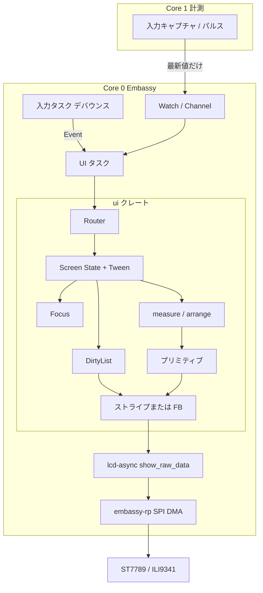
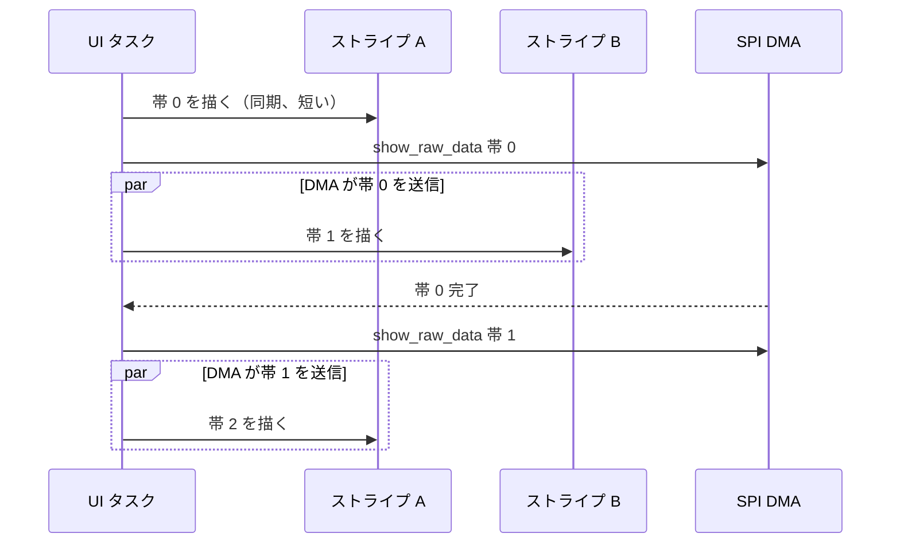

# 組み込み GUI フレームワーク実装設計書

> **来歴 (provenance)**: この文書は utsuroui 実装の出発点として取り込んだ設計書である。
> 本文は原文のまま収録し、実装上の決定・差分・実測値は
> [IMPLEMENTATION_PLAN.md](IMPLEMENTATION_PLAN.md) と
> [ARCHITECTURE.md](ARCHITECTURE.md) に記載する。
> 本文中の「クレート名は未定」「`ui` モジュール」は、実装では `utsuroui` クレートに対応する。

- 対象: lagbuster 系の 2 ボタン機器。240×320 RGB565 の SPI TFT（ST7789 / ILI9341）、Embassy、RP2040 / RP2350
- 日付: 2026-11-28（Asia/Tokyo）
- 位置づけ: **実装用ドキュメント**。この文書と、同ディレクトリの `sketch/` にあるトレイトスケッチがあれば、クレートの骨格を書き始められることを目指す
- 提案 API は未公開の設計案であり、既存クレートのインターフェースではない
- クレート名は未定。本文ではモジュール名として `ui` と呼ぶ
- 実測していない数値、モジュール依存の上限、将来の選択は **想定** / **未実測** と明示する

Buoyant はフォークしない。借りるのは「値が変わったときだけ動くアニメーション」「途中で付け替えても補間がつながる」「RGB565 の色補間」「`next` / `select` の 2 ボタンフォーカス」といったアイデアに限る。中核は最初から dirty-rect、非同期 DMA 転送、RP2040 の RAM 制約を前提にする。

---

## 1. 目標と非目標、他フレームワークとの比較

### 1.1 目標

- `no_std`、原則アロケーションなし（`alloc` は任意フィーチャに閉じる）
- 商用製品にそのまま使えるライセンス。依存は MIT または Apache-2.0 に限定する。GPL や、組み込み製品を無償対象外にするライセンスは入れない
- Embassy の async タスクとして動く。描画の長い同期処理で executor を占有しない
- 同一コードが RP2040（SRAM 264 KB、Cortex-M0+、FPU なし）と RP2350（SRAM 520 KB、Cortex-M33、FPU あり）でビルドできる
- ディスプレイは 240×320、RGB565、SPI、ドライバ IC は ST7789 または ILI9341。転送は `lcd-async` 0.1.3 の矩形書き込みを正面から使う
- 描画プリミティブは `embedded-graphics` 0.8 と相互運用できる
- lagbuster 風の平坦な UI: メニュー、黄色いハイライトバー、ビットマップフォント、矩形と文字で組む図、`31.2 ms` のようなライブ数値、棒グラフ
- ハイライトのスライド、画面のスライド / フェード、数値の tween を、dirty-rect の部分更新で滑らかに出す
- 入力は物理ボタン少数（典型は 2 ボタン）。ロータリーエンコーダとタッチは任意
- 入力遅延計測器として使う場合、UI は計測タイミングを乱さない。計測は core1（または割り込み）に隔離する

### 1.2 非目標

- 汎用デスクトップ GUI や、LVGL / Slint 級のウィジェット一式を最初から揃えること
- アンチエイリアス付きベクトルフォント、リッチな CSS 風レイアウト、スクロール可能な巨大リストを MVP に入れること
- 毎フレーム全画面を 2 本の描画ツリーで補間する方式（Buoyant の中核）を再現すること
- 電子ペーパー、MIP、HDMI、RGB パラレル（DPI）を最初から抽象の中心に据えること（SPI TFT を第一対象にする。8080 パラレルは後から足せる）
- ヒープ前提の即座モード GUI（egui など）を組み込みへ移植すること
- フレームワーク側で計測精度を保証すること。計測はアプリケーションの core1 タスクの責任

### 1.3 比較対象の事実関係（検証済み・出典付き）

ここに書いた内容は、公開ソースと前回の実装調査に基づく。バージョンやコミットは 2026-11-28 時点。

| プロジェクト | ライセンス | `no_std` / alloc | アニメーション | 部分更新 | Embassy | 備考 |
|---|---|---|---|---|---|---|
| **本設計** | MIT OR Apache-2.0 を目標 | 両方。alloc は任意 | 固定小数点 tween + LUT。割り込み可能 | dirty-rect 必須 | 第一級 | 下記の「持つべき機能」をこの前提で選ぶ |
| [Buoyant](https://github.com/riley-williams/buoyant) 0.8.0-alpha.1（調査時 HEAD `9045151`） | MIT OR Apache-2.0 | `#![no_std]`、alloc なし。`unsafe_code = forbid` | 描画ツリー 2 本の補間。linear / ease / cubic / bounce。画面遷移は条件付き View 限定（[issue #156](https://github.com/riley-williams/buoyant/issues/156)） | なし。毎フレーム clear + 全面描画 | 公式連携なし。時刻は `core::time::Duration` | フォーカスは `next` / `previous` / `select`。起動直後は `focus_forward()` が必要。`should_redraw()` は進行中アニメを含まない（`RenderTarget::clear_animation_status()` も見る）。レイアウト約 20 ms・描画約 80 ms・スタック約 30 KB という報告（[issue #133](https://github.com/riley-williams/buoyant/issues/133)）。レイアウト一時データが 15 KiB を超える報告（[issue #170](https://github.com/riley-williams/buoyant/issues/170)）。作者は experimental |
| [Kolibri](https://github.com/Yandrik/kolibri)（`kolibri-embedded-gui` 0.1.0） | MIT OR Apache-2.0 | `#![no_std]` | tween / フェード / スライドのエンジンはない。motion-scheduler 例はピストン段の UI で、汎用アニメーション系ではない | Smartstate によるウィジェット単位の差分再描画。小さいバッファ | 公式例なし | IMGUI。リスト / スクロールは未実装。アルファ。前回確認では 2025-11 以降コミットが止まっていた |
| [Slint](https://github.com/slint-ui/slint) 1.19.1 系 | 複雑（下記） | alloc 必須。ランタイムは宣伝値で 300 KiB 弱 | 第一級。宣言的に書ける | `render_by_line` で走査線バッファ | 公式デモは STM32U5（RAM 3 MB）など。Pico 向け ST7789 サンプルはあるが Embassy 前提ではない | RP2040 / RP2350 + ST7789 の公式サンプルあり。Royalty-free ライセンスは組み込み機器を対象外にする。プロプライエタリな組み込み製品に使うなら Commercial（1 台あたり 1 USD から）か、OSS として GPLv3 で出す必要がある |
| LVGL + Rust バインディング | LVGL 本体は MIT。バインディングは案件による | ヒープと C ツールチェインが要る | 強い（公式ウィジェットとトランジション） | dirty / 部分バッファあり | 公式の Embassy 統合は期待しない | 旧 [`lv_binding_rust`](https://github.com/lvgl/lv_binding_rust) は停滞。新しい `lvgl-rust` は LVGL 9 向けだが重い。本対象の規模には過剰 |
| [embedded-gui](https://github.com/leftger/embedded-gui)（leftger、0.2.7） | 要再確認（前回 MIT/Apache 系） | アロケーションなしを掲げる。ただし crates.io のデフォルトフィーチャが `std` 有効 | イージング、スプリング、画面遷移あり | 差分再描画を掲げる | `embassy` フィーチャあり | 2026-05 登場で若い。git 側が先行している可能性。本番採用は時期尚早と判断 |
| mousefood | 一般に MIT/Apache 系（採用前に再確認） | Ratatui を `embedded-graphics` に載せる文字セル UI | ピクセル単位のハイライトスライドには不向き | セル単位 | 対象外 | ターミナル UI の見た目を TFT に出す用途。本 UI の参照対象にはしない |

使わないもの（ライセンスまたは技術的理由）:

- `embassy-st7789v`: crates.io 上ですべて yanked。ライセンスは GPL-2.0-or-later。**使わない**
- crates.io の `mipidsi-async`: 2023-07-30 のプレースホルダで、実体のある非同期フォークではない。実体は `lcd-async`
- `tween` クレート 2.2.0 を M0+ 上でそのまま使うこと: `no_std` + `libm` で動くが内部は `f32`。ソフトフロートが重い（**想定**）。ホストシミュレータや RP2350 向け任意フィーチャには使ってよい。ターゲット共通経路は自前の固定小数点にする

### 1.4 本設計が持つ機能（must / should / later）

| 優先度 | 機能 | 理由 |
|---|---|---|
| must | `no_std` + 原則 no-alloc | ターゲット制約そのもの |
| must | MIT OR Apache-2.0 の依存だけ | 商用製品。Slint の組み込み有償条件や GPL ドライバを避ける |
| must | dirty-rect と部分転送 | 240×320×2 B = 153,600 B の全面転送は、公式クロック付近だと十数 fps しか出ない（§9.7）。ハイライト移動を滑らかにするには必須 |
| must | `lcd-async` の矩形書き込み（`show_raw_data`） | 検証済みの async API。全面 FB 前提のドキュメントだが、矩形 API が先にある |
| must | RP2040 ではストライプ（帯）バッファ（二重化はバッファ配置として先に確保） | 全面 FB は 153,600 B。RP2040 に載せると残りが苦しい。二重全面は物理的に入らない（§3）。描画と DMA の真のオーバーラップは should / later（§2） |
| must | 固定小数点 tween + イージング LUT | M0+ に FPU がない。ハイライト移動と数値変化に必要 |
| must | 2 ボタンのフォーカス巡回（next / select、戻るは長押しまたは 3 ボタン目） | lagbuster の操作系 |
| must | 矩形塗り、1 px 線、ビットマップフォント、alloc なし数値整形 | UI の見た目の最小集合 |
| must | enum 画面ルータと、フェード / スライドの画面遷移（遷移は should でも、フックは must） | 画面が複数ある前提。見た目の滑らかさは次段でも、状態遷移は最初から入れる |
| must | Embassy タスク分離と、計測を core1 へ隔離する指針 | 入力遅延計測器では UI が計測を汚してはならない |
| must | ホストシミュレータまたは RGB565 バッファのゴールデン画像テスト | 実機なしで描画を固定する |
| should | RP2350 での任意の全面フレームバッファ | フェードやデバッグが簡単になる。必須にはしない（ストライプ経路を共通にする） |
| should | 画面スライド / フェード（既定は黒経由フェード。クロスフェードは RP2350 任意） | 黒経由なら追加 FB が要らない |
| should | TE ピン待ちによるティアリング抑制 | `lcd-async` が TE 出力の設定を持つ。待ちは GPIO 側で自分でやる（§4.6） |
| should | `u8g2-fonts`（フォントライセンスを個別確認したうえで） | 見た目の幅。クレート自体とフォントファイルのライセンスは別（§5、§15） |
| should | センサー値を `embassy-sync` の Watch / Channel から受けて dirty にする | ライブ `31.2 ms` のため |
| should | アニメのないフレームでは sleep し、入力か tween かセンサー更新だけで起きる | 消費電力と計測コアへのバス干渉を減らす |
| should | ビルド時サブセットの日本語グリフ（使う文字列だけ） | フル CJK はフラッシュを食う。英語 UI だけなら後回しでよい |
| later | ロータリーエンコーダ、タッチヒットテスト | 入力モデルに枠だけ先に作っておき、実装は後 |
| later | 角丸矩形、4bpp アンチエイリアスフォント、アイコン RLE | 見た目の磨き。MVP の 1 px 枠と mono フォントで足りる |
| later | スプリング物理 | 固定小数点でも書けるが状態が増える。ease で十分なら後回し |
| later | 本格 Flex / グリッド、仮想化リスト | lagbuster 規模の固定メニューには不要 |
| later | PIO による高速 SPI、または `lcd-async` の 8080 パラレル | 全面アニメの fps を上げたいとき。モジュールと配線次第 |
| later | パネル側 vertical scroll（`set_vertical_scroll_offset`） | `lcd-async` にあるが、向きと固定領域の制約が大きく、汎用遷移には使いにくい |
| later | `alloc` フィーチャでの動的リスト | デバッグやホスト専用に閉じる |

Buoyant から明示的に**持たない**もの: 描画ツリーの二重保持、毎フレーム全面クリア、同期の長い `render_animated`、アニメーション中フラグをターゲット側に隠す設計（`should_redraw` の落とし穴）。アニメの生存はフレームワーク側の tween 表が一箇所で知る。

---

## 2. 全体アーキテクチャ

層を下から積む。上の層は下の層だけに依存し、ウィジェットが SPI を直接叩かない。

1. **HAL / ディスプレイドライバ**  
   `embassy-rp` の SPI（DMA、`write(...).await`）と DC/CS/RST GPIO。その上の `lcd-async::interface::SpiInterface` と `Display<_, ST7789 | ILI9341, _>`。矩形転送の入口は `Display::show_raw_data`。初期化、向き（MADCTL）、色順（RGB/BGR）、オフセットは `lcd-async` の Builder / options に任せる。
2. **フレームバッファ / ストライプ**  
   描画先は `lcd_async::raw_framebuf::RawFrameBuf<Rgb565, &mut [u8]>`。RP2040 では高さ N 行の帯を 2 枚（描画中と転送中）。RP2350 では同じ帯でも、全面 1 枚でもよい。バイト列はすでにパネルへ送れるビッグエンディアン RGB565 になっている（§4.5）。
3. **レンダラ**  
   dirty-rect のリストを受け取り、各矩形を帯に分割して描き、描き終わった帯を DMA で送る。クリッピング、描画順、次帯との重ねはここが担当する。
4. **ウィジェット / ビュー**  
   静的に合成された retained ツリー（§6）。タプルや薄いラッパで組む。状態は画面ごとに 1 つの `State` 構造体として保持する。
5. **レイアウト**  
   measure（希望サイズ）と arrange（座標確定）の 2 パス。固定サイズと縦横スタック、揃え、余白だけを MVP にする（§7）。
6. **状態 / リアクティビティ**  
   ボタンやセンサー更新は `State` を書き換え、影響範囲を dirty に積む。シグナル風の汎用依存グラフは持たない（§8）。
7. **アニメーション**  
   `State` 内の `Tween`（位置、色、値、アルファ）。時刻源は `embassy_time::Instant`。進行中の tween があるフレームだけスケジューラが起きる（§9）。
8. **入力 / フォーカス**  
   別タスクでデバウンスし、UI タスクへ `Event` を送る。フォーカスは画面内の巡回可能な項目のインデックス（§10）。
9. **画面ルータ**  
   `enum` 画面の固定長スタック。遷移アニメの対象もここ（§11）。
10. **アプリループ**  
    core0 の UI タスク。`wait` → 時刻更新 → 入力適用 → tween 進行 → dirty 集約 → レンダラ → また待つ（§12）。



描画と転送の重ね（1 dirty 矩形を帯に分けた場合）:



`show_raw_data` の `.await` が DMA 完了待ちになるので、その間に「次の帯を描く」作業を同じタスク内の同期コードで先にやってから await する、という順序にはしない。await 中は描画に戻れない。重ねるなら、描画を先に済ませた帯を送りつつ、**送っている最中に別の方法で次帯を描く**必要がある。Embassy の単一タスクでは、SPI の DMA 完了を待つ前に次帯を描くのが正しい順序になる。

実装の順序はこうする:

1. 帯 A を描く
2. 帯 A の DMA を起動する（`send_data_slice` が始まれば CPU は空くが、同じ `&mut Display` を握ったまま await すると次が書けない）
3. したがって「起動と await を分けられない」なら、**単一タスクでは帯の描画と転送は直列**になる

これは API 上の重要な制約なので、最初から認める。`lcd-async` の `show_raw_data` は `&mut self` で完了まで待つ。DMA と次帯描画を本当に重ねるには、次のいずれかが要る。

- **二重ストライプ + 分割 API**（should / 後で）: `set_address_window` + `write_memory_start` + `send_data_slice` 相当を自分で分割し、slice 送信中に別バッファへ描く。`lcd-async` の公開 API は `show_raw_data` が一塊なので、重ねたいならインターフェースを薄く包むか、上流相当の処理を自前で持つ。**想定: 0.1.3 の公開 API だけでは、1 つの `Display` に対する描画と転送の真のオーバーラップはできない**
- **MVP では直列でよい**: 帯の描画は 240×16 の塗りと文字で、RP2040 でも 1 ms 未満に収まることが多い（**未実測**）。支配項は SPI 転送時間。直列でも「描画 + 転送」が「転送 + ごく短い描画」になる
- どうしても重ねるなら、バイトバッファを 2 枚持ち、自前で `Interface::send_data_slice` を叩く。これはマイルストーン 3 以降の最適化とする

MVP の宣言: **dirty な帯だけを直列に描いて送る。真の DMA オーバーラップは後で測ってから入れる。**

---

## 3. メモリモデル

### 3.1 固定配置

ヒープは使わない。大きなバッファはすべて `'static` に置く。

```rust
use static_cell::StaticCell;

static STRIP_A: StaticCell<[u8; STRIP_BYTES]> = StaticCell::new();
static STRIP_B: StaticCell<[u8; STRIP_BYTES]> = StaticCell::new(); // 二重化するとき

// 初期化は main で一度だけ
let strip_a: &'static mut [u8; STRIP_BYTES] = STRIP_A.init([0; STRIP_BYTES]);
```

[`static_cell` 2.1.x](https://docs.rs/static_cell/latest/static_cell/) の `init` は `&'static mut T` を返す。`heapless` はフォーカス列やイベントキュー、短い文字列バッファに使う。画面のウィジェット状態は型付きの構造体を `StaticCell` または UI タスクのローカル（`'static` 化された Future のスタックではなく、静的領域が安全）に置く。Embassy タスクのスタックに 150 KB の FB を置かない。

スタックは画面ごとに小さく保つ。Buoyant で報告された「レイアウト一時データがスタックに 15 KiB 以上乗る」（[issue #170](https://github.com/riley-williams/buoyant/issues/170)）を避けるため、measure / arrange の作業領域も静的か、`State` 内の確定済み矩形を使い、大きな再帰はしない。

### 3.2 ピクセル量の計算（正確なバイト数）

画面は 240×320、1 画素 2 バイト（RGB565）。

```
240 × 320           = 76,800 画素
76,800 × 2          = 153,600 バイト  （全面 FB 1 枚）
153,600 × 2         = 307,200 バイト  （全面二重）
240 × 16 × 2        = 7,680 バイト     （16 行ストライプ 1 枚）
7,680 × 2           = 15,360 バイト    （16 行の二重）
240 × 20 × 2        = 9,600 バイト
9,600 × 2           = 19,200 バイト
240 × 32 × 2        = 15,360 バイト
15,360 × 2          = 30,720 バイト
```

チップの SRAM（公式）:

- RP2040: 合計 264 KB = 270,336 バイト。4×64 KB がワードストライプ、加えて 4 KB スクラッチが 2 バンク（`0x20040000`, `0x20041000`）。論理的には連続 264 KB として使える。([RP2040 データシート SRAM 節](https://datasheets.raspberrypi.com/rp2040/rp2040-datasheet.pdf))
- RP2350: 合計 520 KB = 532,480 バイト。8×64 KB ストライプ + 4 KB スクラッチ 2 バンク。([RP2350 product brief](https://pip-assets.raspberrypi.com/categories/1214-rp2350/documents/RP-008374-DS-1-rp2350-product-brief.pdf) / データシート SRAM 節)

比較:

- 全面二重 307,200 B は RP2040 の 270,336 B に**入らない**
- 全面 1 枚 153,600 B は RP2040 に入るが、残り 116,736 B に Embassy、スタック 2 本、計測バッファ、静的データが同居する。入力遅延計測でサンプル列を持つなら苦しくなる
- RP2350 なら全面 1 枚でも残り約 378 KB、全面二重でも残り約 225 KB。余裕はあるが、クロスフェード以外に二重全面は不要

### 3.3 推奨構成

| 項目 | RP2040 | RP2350 |
|---|---|---|
| 描画バッファ | 16 行ストライプ ×2 = 15,360 B を既定 | 同じストライプ経路を共通にする。任意フィーチャで全面 1 枚 153,600 B |
| 二重全面 FB | 採用しない（入らない） | クロスフェード用にだけ任意。既定はオフ |
| 計測用スクラッチ | core1 スタックを 4 KB スクラッチバンクへ（推奨） | 同様 |
| UI タスクスタック | 4〜8 KB を目安（**未実測**。flip-link で測る） | 同左から始めてよい |
| 入力タスクスタック | 2〜4 KB 目安（**未実測**） | 同左 |

### 3.4 RAM 予算表（目安）

数値は「このくらいを枠として確保する」ための**予算**であり、実測ではない。実測は §13 のスタック塗装と `defmt` で行う。

**RP2040（270,336 B）**

| 用途 | 予算 | 根拠 |
|---|---|---|
| 16 行ストライプ ×2 | 15,360 B | 上記の計算。DMA と整合するよう 4 バイト整列 |
| UI / 画面 State + tween 表（16 本程度） | 4,096 B | 固定構造体。超過しないよう型で抑える |
| dirty-rect とレイアウト作業 | 1,024 B | `DirtyList<8>` は数十バイト。余裕を見て確保 |
| Embassy executor + 同期プリミティブ | 8,192 B | 目安 |
| UI タスクスタック | 8,192 B | 目安。超えたら即削減 |
| 入力タスクスタック | 4,096 B | 目安 |
| core1 計測スタック | 4,096 B | スクラッチバンク推奨 |
| 計測リングバッファ（アプリ側） | 16,384 B | UI クレート外。サンプル数はアプリが決める |
| `.bss` / `.data` その他（ Embassy、ドライバ） | 32,768 B | 目安。リンクマップで確認 |
| **小計（枠）** | **約 98 KB** | |
| **残り（マージン）** | **約 166 KB** | XIP キャッシュや USB RAM は含めない |

全面 FB を RP2040 に載せる場合、小計が約 236 KB になり、マージンが 30 KB 台まで落ちる。計測バッファを厚くするならやめる。

**RP2350（532,480 B）**

| 用途 | ストライプ構成 | 全面 FB 構成 |
|---|---|---|
| 画素バッファ | 15,360 B（16 行×2） | 153,600 B（1 枚） |
| その他（上表と同じ枠） | 約 82 KB | 約 82 KB |
| 残りマージン | 約 430 KB | 約 290 KB |

既定は両チップともストライプ。RP2350 で全面 FB を足すのは、フルスクリーンフェードの実装を単純化したいときだけにする。

DMA 用バッファは SRAM 上に置き、フラッシュ（XIP）をソースにしない。`StaticCell` で確保した配列は自動的に SRAM に載る。

---

## 4. レンダリングパイプライン

### 4.1 dirty-rect の追跡

`DirtyList<N>`（既定 `N = 8`）に矩形を積む。画面外はクリップする。空矩形は無視する。

結合規則:

1. 交差していれば結合する
2. ギャップが 1 px 以内で隣接し、かつ結合後の面積 `U` が「元の面積の和 `S` の 1.5 倍以下」（`U * 2 <= S * 3`）なら結合する。大きすぎる結合は SPI 転送を無駄に増やす
3. スロットが満杯なら、無駄が最小の相手と強制結合する。それが 1.5 倍規則を満たさなければ **全面再描画にフォールバック** する
4. 画面遷移の最中など、明らかに全面が汚れるときは最初から `mark_full()` する

実装スケッチは `sketch/src/dirty.rs` にある。しきい値 1.5 と `N=8` は実装開始時の既定で、実機の転送時間を見て調整する。

アニメーションの dirty は「前フレームの矩形 ∪ 今フレームの矩形」にする。ハイライトバーが 16 px 下がるなら、古い位置と新しい位置を含む帯だけが汚れる。色だけが変わる要素は境界が変わらないので、その境界だけでよい。

### 4.2 クリッピングと描画順

`PaintCx` は現在のクリップ矩形を持つ。ウィジェットは自分の bounds とクリップの交差だけに描く。ストライプレンダリングでは、クリップをさらに「今の帯」と交差させる。

描画順は画家アルゴリズム（後ろから前）。MVP では z-index を持たず、ツリーの宣言順を z 順にする。ハイライトバーは行テキストより先に塗り、その上に文字を黒で書く。

透明や半透明があるのはフェード時のアルファ合成に限る（§5.5）。通常のメニューは不透明の塗りつぶしなので、上書き順だけ考えればよい。

### 4.3 ストライプ描画ループ（MVP、直列）

擬似コード:

```rust
async fn flush_dirty(
    display: &mut Display<...>,
    strips: &mut [&'static mut [u8]; 2],
    dirty: &DirtyList,
    screen: Rect,
    paint: impl Fn(&mut RawFrameBuf<Rgb565, &mut [u8]>, Rect /*band in screen coords*/),
) {
    const BAND_H: u16 = 16;
    let regions: &[[Rect]] = if dirty.is_full_redraw() {
        core::slice::from_ref(&screen)
    } else {
        dirty.as_slice()
    };

    for &region in regions {
        let mut y = region.y;
        let y_end = region.bottom() as i16;
        while y < y_end {
            let h = core::cmp::min(BAND_H, (y_end - y) as u16);
            let band = Rect::new(region.x, y, region.w, h);
            let buf = &mut strips[0][..band.area() as usize * 2];
            let mut fb = RawFrameBuf::<Rgb565, _>::new(buf, band.w as usize, band.h as usize);
            // 帯の局所座標 (0,0) が画面の (band.x, band.y) になるよう paint 側で平行移動する
            paint(&mut fb, band);
            display
                .show_raw_data(band.x as u16, band.y as u16, band.w, band.h, fb.as_bytes())
                .await
                .ok(); // エラー方針はアプリで決める
            y += h as i16;
        }
    }
}
```

`RawFrameBuf::new` はバッファが `width * height * 2` より短いと panic する（[lcd-async 0.1.3 ソース](https://docs.rs/lcd-async/0.1.3/lcd_async/raw_framebuf/struct.RawFrameBuf.html)）。スライス長は毎回正確に切る。

帯の高さを汚れた矩形の高さより大きく取ると、左右だけ汚い横長の dirty でも 16 行分を送ることになる。ループは dirty 矩形の `y` 範囲だけを回り、幅は dirty の幅を使う。横 40 px の更新なら 40×16×2 B だけ送る。

### 4.4 `lcd-async` の実際の API（0.1.3 で確認）

出典: クレート 0.1.3 のソース（crates.io、公開 2026-02-26 20:08 UTC = 2026-02-27 05:08 JST）。リポジトリは [okhsunrog/lcd-async](https://github.com/okhsunrog/lcd-async)。ドキュメントは https://docs.rs/lcd-async/0.1.3/lcd_async/ 。ライセンスは MIT。

確認した入口:

```rust
// 矩形の生画素を送る。内部で address window（CASET/RASET 相当）を張り、RAMWR のあと send_data_slice。
pub async fn show_raw_data<DW>(
    &mut self,
    x: u16,
    y: u16,
    width: u16,
    height: u16,
    pixel_data: &[DW],
) -> Result<(), DI::Error>
where
    DI: interface::Interface<Word = DW>,
    DW: Copy;
```

SPI では通常 `Word = u8` なので、`pixel_data` は `&[u8]`。`RawFrameBuf::as_bytes()` をそのまま渡せる。

```rust
let mut fbuf = RawFrameBuf::<Rgb565, _>::new(&mut buffer[..], width, height);
fbuf.clear(Rgb565::BLACK).unwrap();
// DrawTarget: clear / fill_solid / fill_contiguous
let bytes: &[u8] = fbuf.as_bytes();
```

その他、使うもの:

- `Display::set_tearing_effect(TearingEffect::{Off, Vertical, HorizontalAndVertical})`（コマンド 0x34 / 0x35。Vertical はパラメータ 0x00、HorizontalAndVertical は 0x01）
- `set_orientation`、`sleep` / `wake`
- 8080 パラレル用 `interface::ParallelInterface`（later）
- `set_vertical_scroll_region` / `set_vertical_scroll_offset`（later。向きに敏感）

ドキュメントの推奨は「同期で描いて、非同期で送る」。全面を 1 回で送る例が前面に出ているが、部分更新は `show_raw_data` が矩形を受け取るので、設計の中心にしてよい。

最終リリースから本設計時点まで約 9 か月空いている。API が止まるリスクはある。使う面を `show_raw_data` と `RawFrameBuf` に薄く閉じ、必要なら同じ DCS を自前で叩けるようにする。

### 4.5 バイト順（RGB565 エンディアン）

`lcd-async` 0.1.3 の実装は次の通り（ソースで確認済み）:

```rust
impl IntoRawBytes for Rgb565 {
    fn into_raw_bytes(self) -> [u8; 2] {
        RawU16::from(self).into_inner().to_be_bytes()
    }
}
```

つまりバッファ上は **ビッグエンディアン（上位バイトが先）**。ST7789 / ILI9341 の 16-bit 画素を SPI で送る一般的な順序と一致する。ホストの `u16` スライスをリトルエンディアンのまま送ってはいけない。

色がおかしいときは、まず `lcd-async` のトラブルシューティング（色反転、サブピクセル順 RGB/BGR、MADCTL）を当たる。BGR パネルなら `ColorOrder::Bgr` を Builder で指定する。エンドian を自分でひっくり返すのは、上記と矛盾する症状が出てからにする。

COLMOD（0x3A）は 16-bit なら 0x55 が典型。初期化はモデル実装に任せる。

### 4.6 tearing とフレームペース

ST7789 は TE ピンを出せる（TEON = 0x35）。`lcd-async` の `set_tearing_effect` はパネル側の出力を設定するだけ。**MCU が TE を待つ処理はクレートに含まれない。** ティアリングを抑えるなら、TE を GPIO 入力にし、上昇エッジを `embassy` の `Input::wait_for_rising_edge().await` などで待ってから `show_raw_data` を始める。

注意:

- TE は SPI を速くしない。同期のための信号
- 部分更新では、TE 待ちを毎 dirty 矩形でやると遅くなる。1 フレームの最初の転送の前に 1 回待つ、が基本
- モジュールに TE が配線されていないこともある。その場合は「更新を短い時間にまとめる」「ライブ数値の更新を 30 Hz 程度に間引く」で実用上足りることが多い（**想定**）
- 既定の目標は「アニメーション中だけ 30〜45 fps 相当、静止時は 0 fps（イベント待ち）」

### 4.7 SPI クロックの上限

画素 153,600 B = 1,228,800 bit。コマンド（CASET / RASET / RAMWR）と CS/DC の隙間は全面では無視できるが、小さな矩形が何十個もあると効いてくる。だから dirty は結合する。

理論上の全面 fps（オーバーヘッド無視）:

| SCK | 全面 1 枚の理論 fps | 出典・位置づけ |
|---|---|---|
| 15.15 MHz（周期 66 ns） | 約 12.3 fps | ST7789V データシートの 4-wire SPI 書き込み周期の下限に近い値。**公式寄りの上限** |
| 31.25 MHz | 約 25.4 fps | `clk_peri/4` 相当の仮置き |
| 40 MHz | 約 32.6 fps | コミュニティでよく見る値。**モジュール依存、未保証** |
| 62.5 MHz | 約 50.9 fps | RP2040 で `clk_peri = 125 MHz` ならマスタ上限はデータシート上 `clk_peri/2` = 62.5 MHz（133 MHz 動作なら約 66.5 MHz）。パネルが追いつくかは別問題 |

ILI9341 の公式書き込み周期は 100 ns（10 MHz）前後とされることが多く、こちらはさらに遅い可能性がある。必ず実機のモジュールで、ノイズ・飛び・色ずれを見て上げる。

推奨手順:

1. 最初は 15 MHz 前後で正しく出ることを確認する
2. 31.25 MHz、必要なら 40 MHz へ上げ、画像とエラーレートを見る
3. 62.5 MHz は「配線が短く、モジュールが耐える」ときだけ。成功を前提にしない

`embassy-rp` の SPI は `Config { frequency: Hertz, phase, polarity }` と、async DMA の `Spi::new` / `new_txonly`、`write(&mut self, buffer: &[u8]).await` を使う（[embassy-rp SPI](https://docs.embassy.dev/embassy-rp/git/rp2040/spi/struct.Spi.html)）。モードはパネルに合わせる（ST7789 はモード 0 または 3 が多い。モジュールの資料を優先）。

ハイライト移動の例（未実測の計算）: 幅 240、バー高さ 28、移動 16 px なら dirty 高さ 44、転送量 240×44×2 = 21,120 B。31.25 MHz なら約 5.4 ms（理論）。45 fps のフレーム予算 22 ms に十分収まる。全面スライドは SCK が律速で、15 MHz なら約 12 fps、31 MHz なら約 25 fps。

### 4.8 PIO とパラレル（later）

RP2040 / RP2350 の PIO で SPI を自前実装すると、クロックや連続転送の都合がよくなることがある。配線を 8-bit 8080 にできるなら、`lcd-async` の `ParallelInterface` で転送は桁違いに速くなる。どちらも MVP には入れない。SPI で dirty-rect が実用速度を出してから検討する。

---

## 5. プリミティブと文字

### 5.1 塗りと線

最速経路は「同じ色で矩形を埋める」。`RawFrameBuf` の `fill_solid` を使うか、ビッグエンディアンの 2 バイトパターンを帯バッファに `memset` 相当で敷く。ハイライトバー、背景、棒グラフはすべてこの経路。

1 px の線は、水平なら高さ 1 の `fill_solid`、垂直なら幅 1。斜め線は MVP では不要。点線も later。

角丸矩形は later。必要なら `embedded-graphics` の `RoundedRectangle` をストライプにクリップして描く。デフォルトのクロム（ボタン形状）には使わない。lagbuster は 1 px の灰色枠と塗りつぶしで足りている。

### 5.2 ビットマップとアイコン

- 1 bpp: 前景色 / 透明または背景色。アイコンとグリフの基本
- 4 bpp: 16 段階のアルファまたはグレイ。later
- RLE: フラッシュ節約用。later。最初は生の 1 bpp でよい

`embedded-graphics` の `Image` / `ImageRaw` をそのまま描けるようにする。自前形式を先に増やさない。

### 5.3 フォント

優先順:

1. **MVP**: `embedded-graphics` 0.8 付属のモノスペースビットマップ（`FONT_6X10`、`FONT_10X20` など）。ライセンスはクレートと同じ MIT OR Apache-2.0。lagbuster のギザギザした文字に近い
2. **should**: [`u8g2-fonts`](https://github.com/Finomnis/u8g2-fonts)。レンダラ（クレートコード）は MIT OR Apache-2.0。**同梱フォントは U8g2 由来で、フォントごとにライセンスが違う**。[U8g2 の LICENSE](https://github.com/olikraus/u8g2/blob/master/LICENSE) と [フォントグループ wiki](https://github.com/olikraus/u8g2/wiki/fntgrp) を、採用するフォントごとに読む。Adobe X11 由来は著作権表示が必要。OFL のものもある。商用製品にバンドルする前に表を残す
3. **later**: ビルド時に使う文字列から 1 bpp / 4 bpp を焼く自前フォント。日本語はこの経路が本命

日本語グリフ:

- フル Noto などはフラッシュに入らない前提で考えない
- UI が日本語なら、画面で使う文字だけをビルド時に抽出する（メニュー項目、単位、エラー文）
- 計測値の数字と `ms`、`.`、`+`、`-` は ASCII サブセットで常に入れる
- MVP の文書・デバッグ UI は英語 ASCII だけでも実装を進められる

テキスト計測: モノスペースは `char_count * width`。比例フォントはグリフ幅の合計。折り返しは MVP ではしない（1 行ラベル）。クリップは矩形クリップに任せる。

ベースラインと垂直位置は `u8g2-fonts` の `VerticalPosition` に合わせるか、自前で top / center / baseline を持つ。混在すると 1 px ずれるので、クレート内で一つの規則に固定する。

### 5.4 数値整形（alloc なし）

ライブ表示の典型は `31.2 ms`。ヒープも `format!` の `String` も使わない。

推奨:

- 内部は固定小数（例: 312 が 31.2）で持つ
- 表示は `heapless::String<N>`、または `[u8; 16]` に手書きで書く（`sketch/src/example.rs` の `format_ms_x10`）
- `ufmt` 0.2（MIT OR Apache-2.0）を使ってもよい。`core::fmt` も no_std で使えるが、コードサイズと可変引数の重さを見て決める
- 小数桁は表示側で固定し、計測側の丸め規則を一箇所に書く

### 5.5 RGB565 のアルファ合成

フェードと、半透明ハイライト（通常は使わない）のため、チャンネルごとに整数で混ぜる。

```text
out_c = (src_c * a + dst_c * (255 - a)) / 255
```

R は 5 bit、G は 6 bit、B は 5 bit のまま計算する（`sketch/src/color.rs` の `blend_rgb565`）。ガンマ補正はしない。色 tween も同じ関数で、`t`（0..=65535）を 8 bit アルファに落として使う。

黒経由フェードは、各画素を黒と混ぜるか、不透明な黒矩形のアルファを上げる。後者は全面 dirty になるが、追加 FB は要らない。既知の背景色だけで構成された画面なら、背景と前景をそれぞれ黒へ tween しても再現できる。

---

## 6. ウィジェット / ビューモデル

### 6.1 選択と理由

採用するのは **静的合成の retained ウィジェット + State 内 tween + dirty-rect** である。Buoyant のような宣言的な見た目は残すが、描画ツリーは 2 本持たない。

| 方式 | 採用するか | 理由 |
|---|---|---|
| Immediate mode（Kolibri 型） | 採用しない | 毎フレームウィジェット関数を呼び直すのは書き味が軽いが、ハイライト位置の「前フレームの境界」を安定して取るのが難しい。差分更新とアニメの identity が弱くなる |
| Buoyant 型（宣言的 View + 描画ツリー 2 本の補間） | 採用しない | RAM と全面再描画が本設計の前提と衝突する。レイアウトと描画が同期で重い報告もある |
| 完全な retained 木をヒープで作る | 採用しない | alloc が要る。動的な insert/remove は本 UI にほとんどない |
| **静的合成 retained（本設計）** | 採用 | 画面はコンパイル時に型で組める。State は画面と同寿命。tween はプロパティ単位。dirty は境界の union |

ウィジェット値（`LagMenu { items: ... }`）は記述子で、毎フレームスタックに作ってよい。保持するのは `State` だけ。アニメーションは「新旧の描画ツリーを補間する」のではなく、「`highlight_y: Tween` のようなスカラーを補間し、その結果で描く」。

### 6.2 トレイト（提案 API）

以下は設計案。`sketch/` で `thumbv6m-none-eabi` の `cargo check` が通る形にしてある。

```rust
pub struct MeasureCx { pub max: Size }

pub struct PaintCx { /* clip、ストライプへの fill / text など */ }

pub trait Widget {
    type State: Default;

    fn measure(&self, cx: &MeasureCx, state: &Self::State) -> Size;
    fn arrange(&self, bounds: Rect, state: &mut Self::State);
    fn event(&self, ev: &Event, state: &mut Self::State, out: &mut EventOut);
    fn paint(&self, cx: &mut PaintCx, state: &Self::State);
}
```

`paint` は現在の tween 値（呼び出し側が直前に `value_at(now)` を State に反映するか、`paint` 内で `now` を読む）で描く。dirty の集約は、

- 入力や外部値が `event` / `apply_sensor` で State を変えたとき
- tween が動いているとき、対象プロパティの旧境界 ∪ 新境界

を `DirtyList` に足す。ウィジェット側に `dirty_bounds(&self, state) -> Rect` を足してもよい。MVP では画面が「今回動いた要素の矩形」を知っている方が実装が速い。汎用の自動追跡は、プロパティを `AnimProp` で包んでからにする。

フォーカス可能な項目は、画面 State の `Focus { index, count }` をウィジェットが更新する。子孫が動的に増えることは、固定 `heapless::Vec` か固定配列の範囲でしか許さない。

### 6.3 合成

タプルと薄いラッパで組む。マクロは、同じ実装を 8 要素まで展開するときにだけ使う（手書きの `(A, B)`、`(A, B, C)` でも始まれる）。

```rust
pub struct VStack<A, B> { pub top: A, pub bottom: B, pub gap: u16 }
pub struct Padding<W> { pub inner: W, pub edges: Edges }
pub struct Background<W> { pub inner: W, pub color: Rgb565 }
```

`VStackState` は子の State と、確定した子の `Rect` を持つ。これで再 measure せずに hit test や dirty が取れる。

リストは次のどちらか。

- 固定 `&'static [&'static str]`（lagbuster のメニューに十分）
- `heapless::Vec<T, N>` または `[T; N]`。`N` はコンパイル時定数

ウィジェット trait object（`dyn Widget`）は MVP では使わない。画面は `enum` で静的に分岐する（§11）。

### 6.4 描画ツリーを持たないことの帰結

色フェードや位置スライドは「そのプロパティ用 Tween があるものだけ」ができる。Buoyant のように任意の修飾子を後から `.animated(...)` で包んでツリー差分に任せる、という自由度は下がる。代わりに RAM が予測でき、部分更新が素直になる。よく使うパターン（ハイライト Y、文字色、数値、画面オフセット、オーバーレイアルファ）は、最初からヘルパとして用意する。

---

## 7. レイアウト

MVP の機能:

- 固定サイズ（数値読み出し、アイコン）
- `VStack` / `HStack`（ギャップ、主軸の開始 / 中央 / 終端、交差軸の揃え）
- `Padding`（四辺）
- 子が余白を埋める `Expand`（1 個だけ、という制限でよい）

持たないもの（later）: 重み付き Flex の複数 expand、グリッド、折り返し、絶対配置の汎用 z スタック（重ねは画面が明示的に絵を重ねる）。

2 パス:

1. `measure(max)` が希望サイズを返す。子は親の max を受けて自分の希望を返す。テキストは折り返さないので、測るコストは項目数に線形
2. `arrange(bounds)` が実座標を `State` に書く

コストの上限（目標であり未実測）: lagbuster 規模（項目 10 個未満、深さ 3 以下）の measure + arrange は 1 ms 未満を目指す。再レイアウトは「画面初期化」「フォーカス数の変化」「画面サイズ変化」のときだけで、毎フレームはやらない。アニメで動くのは既に arrange された座標の上の tween 値（例: ハイライト Y）に限る。

例外: 画面スライドは画面全体のオフセット tween で、子を再レイアウトしない。

スタック使用量を抑えるため、measure の再帰は画面の深さまで。大きな一時配列をスタックに置かない。Buoyant issue #170 と同じ轍を踏まない。

---

## 8. 状態とリアクティビティ

汎用のシグナル依存グラフは持たない。画面 State は普通の Rust 構造体。更新経路は次の 3 つだけに固定する。

1. **入力**: `event()` が State を変え、dirty を出す
2. **tween の進行**: UI ループが `now` を渡し、動いている tween の旧∪新境界を dirty にする。完了した tween は `running = false`
3. **他タスクからの値**: 計測タスクが最新の遅延を `embassy_sync::watch::Watch<u16>`（または同等のスロット）に書く。UI タスクはフレームの先頭で `try_get` または `changed()` を見る。値が変わっていれば State を更新し、数字と棒グラフの矩形だけ dirty にする

`Watch` は最新値だけ残せばよいライブ計測に向く。履歴が必要ならアプリ側のリングバッファ（core1 または共有 SRAM）に置き、UI は要約だけ読む。`Channel` はイベント性のもの（校正完了、エラー）に使う。UI が計測側のロックを長く取らない。`CriticalSectionRawMutex` で短く atomic に近い受け渡しにするか、lock-free の `Watch` を使う。

dirty の対応表:

| 変化 | dirty にする範囲 |
|---|---|
| フォーカス移動 | ハイライトの旧位置 ∪ 新位置。文字色が変わる行があればその 2 行も |
| 数値更新 | 数字のグリフ矩形（少し余裕を取る）と棒グラフ。桁数が増えて幅が変わるときは旧幅 ∪ 新幅 |
| 画面遷移 | 原則全面。黒フェードも全面 |
| 設定トグル | その行、またはそのコントロールの境界 |

「何が変わったか分からない」場合だけ全面に落とす。センサーが 1 kHz で更新されても、表示は 20〜30 Hz に間引く（§9.6）。Dirty を毎ミリ秒積む必要はない。

---

## 9. アニメーション

### 9.1 時刻源

`embassy_time::Instant::now()` と `elapsed()` を使う。内部の tween はすべてマイクロ秒の `u64` で持つ（`Duration::as_micros()`）。`core::time::Duration` への変換は境界だけ。ホストシミュレータでは仮想時計を差し込めるように、`now_us()` をトレイトまたは関数ポインタ相当（ジェネリックの `Clock`）にしてもよい。MVP では関数引数 `now_us: u64` で足りる。

Buoyant の落とし穴をコピーしない。`should_redraw` 相当は「dirty がある、または running な tween がある、または画面遷移中」をフレームワークが自分で返す。

### 9.2 固定小数点 tween

正規化時刻 `t` は `Q16`（0..=65535）。補間:

```text
out = (from * (65535 - t) + to * t) / 65535
```

計算は `i64` で行い、Cortex-M0+ でもソフトフロートを使わない。イージングは `t` を歪ませてから lerp する。

実装スケッチ: `sketch/src/anim.rs` の `Tween::value_at` / `retarget`。

`tween` クレート（2.2.0、MIT OR Apache-2.0、`no_std` + `libm` で `f32`）はホストテストや RP2350 の任意フィーチャには使ってよい。共通経路にはしない。

### 9.3 イージング LUT

本番は多項式近似ではなく、256 要素の `u16` テーブル + 隣接点の線形補間にする。テーブルは `const` でフラッシュに置く。RAM は使わない。

MVP で用意する曲線:

- Linear
- EaseIn（approx. quadratic / cubic）
- EaseOut
- EaseInOut

bounce は later（ハイライトには不要）。スプリングは later。スプリングを足すときは位置だけでなく速度を State に持つ。

### 9.4 割り込み可能な付け替え（retarget）

フォーカスを連打したとき、動いているハイライトを途中から新しい行へ送り直す。`retarget(now, new_to, duration)` は現在値を新しい `from` にし、時刻を振り直す。duration は同じ 120 ms でよい。これが Buoyant から借りる操作感の中心。

位置（Y）、色（RGB565）、数値（固定小数）、アルファ（0..=255）を同じ `Tween` で扱う。色は `lerp_rgb565`。

同時に動く tween の本数は上限を決める（例: 16）。画面 State のフィールドとして持てば、動的テーブルは不要。汎用テーブルが欲しければ `heapless::Vec<Tween, 16>`。

### 9.5 画面遷移と転送量

| 種類 | やり方 | dirty / 帯域 | 追加 RAM |
|---|---|---|---|
| カット | 次画面を描いて全面更新 1 回 | 153,600 B を 1 回 | なし |
| 黒経由フェード | オーバーレイアルファを 0→255→0。途中で画面を差し替え | 毎フレーム全面。15 MHz なら約 12 fps、31 MHz なら約 25 fps | なし |
| スライド | 旧画面と新画面を横または縦にオフセットして両方描く | 毎フレーム全面。描画コストは約 2 画面分（クリップする） | なし（どちらもその場で描く）。旧画面の FB は持たない |
| クロスフェード | 2 画面を画素単位で混ぜる | 毎フレーム全面 + 読み出しが要る | 旧画面のスナップショット 153,600 B。RP2040 では原則やらない |

既定はカットと黒経由フェード、任意でスライド。クロスフェードは RP2350 の任意フィーチャ。

スライド中は dirty を全面にする。部分更新で正しさを保つより、実装を単純にする。

### 9.6 フレームスケジューラ

```text
loop {
    let now = Instant::now();
    apply_inputs();
    apply_sensor_if_due(now);      // 表示は 30 Hz などに間引き
    let animating = tick_tweens(now);
    if dirty.is_empty() && !animating && !transitioning {
        // 入力 Event、Watch の変更、または次 tween なし、で待つ
        wait_for_work().await;
        continue;
    }
    paint_and_flush().await;       // 帯ごとに await。ここで executor に譲る
    if animating || transitioning {
        // 目標フレーム間隔まで待つ（例: 22 ms ≈ 45 fps）。TE があればその上昇を待つ
        Timer::after(FRAME_BUDGET).await;
    }
}
```

静止時は SPI も走らせない。計測コアとの SRAM バンク競合も減る。

### 9.7 目標 fps と SPI 帯域

全面 1,228,800 bit を SCK で割った値が理論上限（§4.7）。ハイライトだけなら転送は数十 KB で、45 fps は 31 MHz でも、理論上は余裕がある。律速になりやすいのは画面遷移の全面転送と、描画自体が重い場合。

目標:

- メニューのハイライト移動: 30〜45 fps
- ライブ数値: 20〜30 Hz で十分（人が読めればよい）
- 画面フェード / スライド: SCK が許す全面 fps（15 MHz なら ≈12、上げられれば 25〜30）
- 静止: 0 fps

FRAME_BUDGET を 22 ms にしても、全面転送が 80 ms かかるクロックなら実 fps はそれに落ちる。予算は「それ以上急がない」ための上限。

---

## 10. 入力とフォーカス

### 10.1 ボタン（async デバウンス）

入力は UI タスクと分ける。典型実装:

- GPIO を `Pull::Up` で取り、エッジを `wait_for_low` / `wait_for_high` で待つ
- 変化のあと `Timer::after_millis(10〜20)` して、まだ同じなら確定（デバウンス時間は **要実測**、機械接点による）
- 確定イベントを `embassy_sync::channel::Channel<CriticalSectionRawMutex, Event, 8>` へ送る

長押し: press 確定時刻を覚え、500 ms（設定可能）経過してまだ押されていれば `Event::LongPress`。その後 8〜10 Hz で `Event::Repeat` を出してもよい（フォーカスの連送用）。2 ボタン機器では「短い次へ / 長い戻る」をここに割り当てる。

### 10.2 2 ボタンの割り当て

lagbuster 想定の既定:

| 物理入力 | Event | 意味 |
|---|---|---|
| ボタン A 短押し | `Next` | フォーカスを次へ。ハイライトを tween |
| ボタン B 短押し | `Select` | 決定。画面 push や測定開始 |
| ボタン A 長押し | `Back` | ルータ pop。3 ボタン目があるなら短押し Back でもよい |
| ボタン B 長押し | 任意（設定など）。MVP では未使用でもよい | |

`Previous` は 3 ボタン目か、エンコーダ、または「先頭の次が末尾」の循環だけで足りることが多い。循環で足りるなら `Previous` は実装するが、既定の 2 ボタンには割り当てない。

起動直後から index 0 にフォーカスを置く。Buoyant のように `focus_forward()` を呼び忘れると最初の項目が選ばれない、という状態を作らない。

### 10.3 フォーカスの見た目

フォーカス行は黄色いバー（または行背景）+ 黒文字。バーの Y は `Tween`。フォーカス枠をバーと別に描く必要は、MVP ではない。

フォーカス対象は画面が `Focus { index, count }` で持つ。ネストしたフォーカス（パネルの中の行）は later。MVP のメニューは平坦。

### 10.4 ロータリーとタッチ（later、枠だけ先に）

`Event::Encoder(i16)` は相対ステップ。フォーカスの `next` / `previous` に足す。デバウンスと 1 detent 1 ステップは入力タスク側。

`Event::Touch { x, y, down }` は arrange 済みの子 `Rect` に対する hit test。押した項目へフォーカスを飛ばし、up で select、が基本。ジェスチャは持たない。キャリブレーションと回転（MADCTL と座標の一致）はドライバ層の責任。

---

## 11. 画面ルータ

画面はアプリの `enum` にする。フレームワークは「画面 ID の固定長スタック」と遷移ステートマシンだけを提供してもよいし、アプリの enum をジェネリックに載せる。

```rust
enum Screen {
    Menu(LagMenuState),
    Measure(MeasureState),
    Settings(SettingsState),
    About,
}

enum NavAction { Push(...), Pop, Replace(...) }
```

`Router<N>` のスケッチは `sketch/src/nav.rs`。ルートは pop できない。深さ `N=4` 程度で足りる想定。

戻る動作: `Event::Back` または画面が出す `NavAction::Pop`。遷移中は入力を無視するか、遷移を打ち切って直ちに切る（どちらにするかはオープン。既定案は「打ち切ってカットで戻る」）。

遷移ステート:

```text
Idle
FadeOut { t, next: NavAction }
FadeIn { t }
Slide { t, from, to, dir }
```

`FadeOut` 完了時にスタックを書き換え、`FadeIn` に入る。State の寿命: pop される画面の State はスタックから外れた時点で捨てる。push される画面は `Default` で作る。入力を跨いで残したい値は、画面の外の `AppState`（計測結果など）に置く。

---

## 12. Embassy 統合

### 12.1 タスク配置（入力遅延計測器を正面に置く）

原則: **計測の時間精度を UI より上に置く。** SPI の待ち、フォント描画、dirty 結合が、入力タイムスタンプや出力パルスのジッタになってはならない。

推奨（RP2040 / RP2350 とも双コア）:

| コア | 役割 | 注意 |
|---|---|---|
| **Core 1** | 計測だけ。GPIO 入力の時刻、出力パルス、必要なら PIO / タイマキャプチャ。Embassy の割り込み executor か、ほぼベアなループ | UI の `CriticalSection` を計測経路で取らない。ログも最小。スタックはスクラッチバンクが望ましい |
| **Core 0** | Embassy 既定 executor。入力デバウンス、UI ループ、SPI DMA、（任意の）ログ | DMA 完了割り込みはここのバスを使うが、core1 のサイクル精度キャプチャとは分離できる |

core1 の起動は `embassy_rp::multicore::spawn_core1`（API は使用時の embassy-rp 版で確認する）。共有は `Watch` または atomic なスロット。core1 は「最新の計測値を書く」だけで、UI の完了を待たない。

単コアに落とすのは劣化モードと明記する。その場合だけ、計測を `InterruptExecutor`（高優先度）に載せ、UI はスレッドモード executor に残す。SPI DMA 割り込みが計測割り込みより優先されないよう、NVIC 優先度を明示する。入力遅延計測器としては非推奨。

### 12.2 チャネルと連携

```text
[core1 計測] --Watch<Latency>--\
                                 \ 
[入力タスク] --Channel<Event,8>--> [UI タスク] --show_raw_data--> SPI DMA
[TE GPIO 待ち（任意）] ----------/
```

UI タスクが他タスクをブロックしてよいのは `.await` だけ。`spin` や長い critical section は持たない。

### 12.3 長い同期処理を避ける

- レイアウトはイベント時だけ（§7）
- 1 回の同期描画は「1 ストライプ（最大 240×16）」に閉じる。終わったら `show_raw_data` で await し、executor に譲る
- 全面 dirty でも、帯のあいだで await するので、入力タスクは動ける。ただし同一コアの計測割り込みがなければ、帯描画の数十〜数百 µs はマスクされない通常の処理として走る
- フォント描画が重いと感じたら（**未実測**）、1 帯の途中でも「文字グリフ単位で切れない範囲」で帯を細かくする

真の DMA / 描画オーバーラップは §2 の制約どおり later。

### 12.4 UI ループの骨格（提案）

```rust
#[embassy_executor::task]
async fn ui_task(
    mut display: Display<...>,
    events: Receiver<'static, CriticalSectionRawMutex, Event, 8>,
    latency: WatchReceiver<'static, ... , u16>,
    strips: [&'static mut [u8]; 2],
) {
    let mut app = App::new(); // Router + 画面 State
    let mut dirty = DirtyList::new(SCREEN);
    dirty.mark_full();
    let mut last_latency_paint = 0u16;

    loop {
        let now = Instant::now().as_micros();

        while let Ok(ev) = events.try_receive() {
            app.event(&ev, &mut dirty);
        }
        if let Some(v) = latency.try_get() {
            if v != last_latency_paint && enough_time_since_last_numeric() {
                app.set_latency(v, &mut dirty);
                last_latency_paint = v;
            }
        }

        let animating = app.tick(now, &mut dirty);
        if dirty.is_empty() && !animating {
            match select(events.receive(), latency.changed(), app.next_wakeup()).await {
                // 起きたら loop 先頭へ
                _ => continue,
            }
        } else {
            app.flush(&mut display, strips, &dirty).await;
            dirty.clear();
            if animating {
                Timer::after(FRAME_BUDGET).await;
            }
        }
    }
}
```

`next_wakeup` は進行中 tween の終了時刻か、数値の間引き周期。`select` の正確な型は embassy の `futures_util` / `embassy_futures::select` に合わせる。

---

## 13. テストとツール

### 13.1 ホストシミュレータ

2 系統を用意する。どちらも `std` フィーチャ。

1. **ゴールデン画像（先に必須）**  
   全面 RGB565 バッファに描き、PNG または raw に落として比較する。差分が出たら失敗。アニメは `now_us` を固定して数フレームを保存する（例: ハイライト移動の t=0, 60ms, 120ms）。CI 向け。依存は `embedded-graphics` と画像書き出し（`png` クレートなど。ライセンス確認のうえ）。SDL は不要
2. **SDL シミュレータ（should）**  
   [`embedded-graphics-simulator`](https://docs.rs/embedded-graphics-simulator) でキーボードを 2 ボタンに割り当て、リアルタイム確認する。 Embassy はホストでは普通に動かないので、ループは同期 + 仮想時計でよい

ターゲット専用の `lcd-async` 呼び出しは `DisplayDriver` トレイトの裏に隠し、ホストではバッファ実装を使う。

### 13.2 実機ベンチ

- 帯描画、`show_raw_data`、1 フレーム全体を `embassy_time` または `defmt` のタイムスタンプで測る
- サイクル数が欲しければ `cortex_m::peripheral::DWT`（M0+ の RP2040 には CYCCNT がない）。RP2040 ではタイマー、RP2350（M33）では DWT が使える
- フレーム間の最大 / 平均をデバッグ画面か RTT に出す

### 13.3 RAM とスタック

- リンカに [`flip-link`](https://docs.rs/flip-link/0.1.12/flip_link/)（MIT OR Apache-2.0）を使い、スタック溢れを初期に発見する
- スタック塗装（起動時にパターンで埋め、最低水位を読む）で UI タスクと入力タスクの実使用を測る
- `cargo size` とリンカマップで `.bss` のストライプ、FB、静的 State を確認する

### 13.4 フィーチャフラグ（案）

| フィーチャ | 既定 | 内容 |
|---|---|---|
| `std` / `simulator` | off | ホストテスト、SDL |
| `alloc` | off | 使わない。将来の動的リスト用に名前だけ予約してもよい |
| `u8g2` | off | `u8g2-fonts`。フォントライセンスはアプリが選ぶ |
| `full-fb` | off | 全面フレームバッファ経路。RP2350 向け |
| `tearing` | off | TE 待ちヘルパ |
| `defmt` | off | ログ。`lcd-async` も `defmt` フィーチャを持つ |
| `touch` / `encoder` | off | 入力の追加経路 |

ターゲットは `thumbv6m-none-eabi`（RP2040）と `thumbv8m.main-none-eabihf`（RP2350 の Arm + FPU）で CI の `cargo check` を回す。

---

## 14. API 例（提案設計であり、既存クレートではない）

次のコードは **本設計の提案 API** で、lagbuster 風の 2 ボタンメニュー、ハイライトのスライド、ライブの `31.2 ms` と棒グラフを一つの画面に載せる例である。公開されているライブラリのサンプルではない。型の骨格は `sketch/src/example.rs` にある。

```rust
// 提案 API の使用例（未実装のクレートを想像して書いている）

const ITEMS: &[&str] = &["Measure", "Settings", "About"];
const ROW_H: u16 = 28;
const HIGHLIGHT_US: u32 = 120_000;
const SCREEN: Rect = Rect::new(0, 0, 240, 320);

struct LagMenu;
struct LagMenuState {
    focus: Focus,
    highlight_y: Tween,
    /// 31.2 ms を 312 として持つ
    latency_x10: u16,
    bounds: Rect,
}

impl Default for LagMenuState {
    fn default() -> Self {
        Self {
            focus: Focus::new(ITEMS.len() as u8), // 起動時から index 0
            highlight_y: Tween::settled(0),
            latency_x10: 0,
            bounds: SCREEN,
        }
    }
}

impl LagMenuState {
    fn row_y(index: u8) -> i32 {
        index as i32 * ROW_H as i32
    }

    fn event(&mut self, ev: &Event, dirty: &mut DirtyList, now_us: u64) {
        let old = self.highlight_rect();
        match ev {
            Event::Next => {
                self.focus.next();
                self.highlight_y.retarget(now_us, Self::row_y(self.focus.index), HIGHLIGHT_US);
                dirty.add(old.union(self.highlight_rect_target()));
            }
            Event::Select => { /* ルータへ Push(Measure) など */ }
            Event::Back => { /* ルータ Pop */ }
            _ => {}
        }
    }

    fn set_latency(&mut self, latency_x10: u16, dirty: &mut DirtyList) {
        if self.latency_x10 == latency_x10 {
            return;
        }
        dirty.add(self.readout_rect());
        self.latency_x10 = latency_x10;
        dirty.add(self.readout_rect());
    }

    fn tick(&mut self, now_us: u64, dirty: &mut DirtyList) -> bool {
        if !self.highlight_y.is_running(now_us) {
            return false;
        }
        let before = self.highlight_rect();
        // value_at は描画時に読む。dirty は旧∪新
        let after = Rect::new(8, self.highlight_y.value_at(now_us) as i16, 224, ROW_H);
        dirty.add(before.union(after));
        self.highlight_y.is_running(now_us)
    }

    fn paint(&self, cx: &mut PaintCx, now_us: u64) {
        cx.fill_rect(SCREEN, BLACK);

        let hy = self.highlight_y.value_at(now_us) as i16;
        cx.fill_rect(Rect::new(8, hy, 224, ROW_H), YELLOW);

        for (i, label) in ITEMS.iter().enumerate() {
            let y = i as i16 * ROW_H as i16;
            let focused = (i as i32) == (hy / ROW_H as i16 as i32) // 描画は色を行単位にしてもよい
                || self.focus.index as usize == i;
            // 実装では「バーに覆われているか」ではなく focus index と tween 中の補間色でもよい。
            // 単純版: フォーカス行だけ黒文字、他は白。tween 中はバーだけが動く。
            let color = if self.focus.index as usize == i { BLACK } else { WHITE };
            let _ = (label, color, y, focused);
            cx.text(*label, Point { x: 16, y: y + 6 }, color);
        }

        // ライブ数値。alloc なし。
        let mut buf = [0u8; 8];
        let s = format_ms_x10(self.latency_x10, &mut buf); // "31.2 ms"
        cx.text(s, Point { x: 16, y: 280 }, WHITE);

        let bar_w = ((self.latency_x10 as u32 * 200) / 1000).min(200) as u16;
        cx.fill_rect(Rect::new(16, 300, bar_w, 8), YELLOW);
        cx.stroke_rect(Rect::new(16, 300, 200, 8), WHITE); // 1px 枠
    }

    fn highlight_rect_at(&self, y: i32) -> Rect {
        Rect::new(8, y as i16, 224, ROW_H)
    }
    fn highlight_rect(&self) -> Rect {
        // 本番では last_painted_y を State に残し、その矩形を返す。
        // ここは from/to の union を dirty に使うための簡略版。
        self.highlight_rect_at(self.highlight_y.from)
            .union(self.highlight_rect_at(self.highlight_y.to))
    }
    fn highlight_rect_target(&self) -> Rect {
        self.highlight_rect_at(self.highlight_y.to)
    }
    fn readout_rect(&self) -> Rect { Rect::new(16, 276, 208, 36) }
}
```

UI ループ側での使い方は §12.4。2 ボタンは入力タスクが `Event::Next` / `Event::Select` に変換する。計測タスクは `latency` Watch に `312` を書く。

バーを行背景として動かし、文字は常に同じ位置に描き直すのが dirty-rect と相性がよい。文字色を白↔黒でクロスフェードさせるなら、行テキストの矩形も dirty に入れる。

---

## 15. クレート構成、依存関係、マイルストーン、リスク

### 15.1 モジュール構成（案）

単一クレートから始めてよい。大きくなったら `ui-core` / `ui-embassy` に分ける。

```text
ui/
  src/lib.rs          // no_std、再エクスポート
  src/geom.rs         // Point, Size, Rect
  src/color.rs        // RGB565 blend / lerp
  src/dirty.rs        // DirtyList
  src/anim.rs         // Tween, Easing, LUT
  src/event.rs        // Event, EventOut
  src/widget.rs       // Widget, VStack, Padding, PaintCx
  src/text.rs         // 計測、フォント抽象、数値整形
  src/focus.rs
  src/nav.rs          // Router, 遷移ステート
  src/render.rs       // ストライプループ、DisplayDriver
  src/driver.rs       // lcd-async 実装（ターゲット）
  src/input.rs        // デバウンスヘルパ（embassy フィーチャ）
  src/app.rs          // ループ骨格
  tests/golden.rs     // ホスト、std
sketch/               // 本設計書付属の型チェック用。製品クレートではない
```

Git リポジトリの作成や push は、この文書の作業範囲には含めない。

### 15.2 依存関係とライセンス

採用してよいもの（いずれも MIT、または MIT OR Apache-2.0。版は実装開始時に再確認）:

| クレート | 用途 | ライセンス（確認時点） | メモ |
|---|---|---|---|
| `lcd-async` 0.1.3 | 非同期 TFT、`show_raw_data` / `RawFrameBuf` | MIT | 最終リリース 2026-02-27 05:08 JST 相当。保守が止まるリスクあり |
| `embedded-graphics` 0.8 | DrawTarget、プリミティブ、付属フォント | MIT OR Apache-2.0 | 必須の相互運用面 |
| `embedded-hal` 1.0 / `embedded-hal-async` 1.0 | `lcd-async` の前提 | MIT OR Apache-2.0 | |
| `embassy-rp` / `embassy-executor` / `embassy-time` / `embassy-sync` / `embassy-futures` | チップ、タスク、時刻、チャネル | MIT OR Apache-2.0 | 版はワークスペースに合わせる |
| `static_cell` 2.x | `'static mut` バッファ | MIT OR Apache-2.0 | `init` が `&'static mut T` を返す |
| `heapless` 0.8/0.9 | 固定長 Vec / String / キュー | MIT OR Apache-2.0 | |
| `ufmt` 0.2（任意） | 軽い整形 | MIT OR Apache-2.0 | 手書き整形でもよい |
| `defmt`（任意） | ログ | MIT OR Apache-2.0 系（導入時に確認） | |
| `flip-link` 0.1.x（dev / リンク） | スタック溢れ検出 | MIT OR Apache-2.0 | |
| `embedded-graphics-simulator`（dev） | SDL シミュレータ | MIT OR Apache-2.0 | `std` のみ |
| `u8g2-fonts`（任意フィーチャ） | 追加フォント描画 | **コードは MIT OR Apache-2.0。フォントは別ライセンス** | 使うフォントごとに U8g2 wiki を確認し、著作権表示を残す |
| `tween` 2.2（任意、ホスト / RP2350） | 使わなくてもよい | MIT OR Apache-2.0 | 内部 `f32`。M0+ 共通経路には使わない |

使わないもの:

- `embassy-st7789v`（yanked、GPL-2.0-or-later）
- Slint を製品ファームにリンクすること（組み込みは Royalty-free 対象外。商用契約か GPLv3 が要る）
- LVGL を本クレートの必須依存にすること（ツールチェインとサイズ。必要ならアプリが別途）

アプリが `u8g2-fonts` の特定フォントを入れるとき、そのフォントの条件（OFL、Adobe 表示義務、再配布制限など）はアプリのライセンス文書に書く。フレームワークの既定サンプルは `embedded-graphics` 付属フォントだけにする。

### 15.3 マイルストーン

**M0 — 骨格（これで「点が塗れる」）**

- `geom` / `color` / `dirty` / `anim` の単体テスト（ホスト）
- `RawFrameBuf` + `show_raw_data` で、べた塗りと 1 px 枠を実機に出す
- ストライプ経路で全面赤 / 黒を切替
- SPI を 15 MHz から上げて、そのモジュールの安定クロックを記録する

**M1 — MVP UI**

- `Widget` + `VStack` + 固定メニュー
- 2 ボタン入力、デバウンス、フォーカス、決定
- ビットマップフォントと `format_ms_x10`
- dirty-rect で数値とフォーカス行だけ更新（まだ tween なしでもよい）
- enum ルータ（カット遷移）
- ゴールデン画像テスト 数枚
- core0 / core1 の分離指針どおり、ダミー計測値を Watch で表示

**M2 — アニメーション**

- ハイライト Y の retarget tween（120 ms、ease-in-out）
- 数値の軽い tween（任意）
- 黒経由フェード
- 静止時 sleep、アニメ中のフレームペース
- 必要なら TE 待ち

**M3 — 磨き**

- 画面スライド
- `u8g2` またはビルド時日本語サブセット
- DMA オーバーラップ（測って効果があるときだけ）
- エンコーダ / タッチ
- RP2350 の `full-fb` とクロスフェード
- スタック実測、RAM 予算の更新、SPI 実測表をこの文書に追記

### 15.4 リスク

| リスク | 影響 | 緩和 |
|---|---|---|
| パネルが公式に近い SCK しか受けない | 全面遷移が十数 fps | dirty-rect を必須にしている。遷移はフェード枚数を減らすか、カットにする |
| `lcd-async` の更新停止や API 不足（TE 待ちなし、転送と描画のオーバーラップ不可） | 最適化が詰まる | 使う面を薄く閉じ、DCS を自前で叩く逃げ道を残す |
| RGB565 のバイト順・BGR をモジュールで間違える | 色が化ける | 0.1.3 は BE と確認済み。問題時は MADCTL / ColorOrder を先に疑う |
| Buoyant 並みの宣言的自由度を後から欲しくなる | 設計のやり直し | 最初から「プロパティ tween」に割り切る。ツリー補間は持ち込まない |
| UI が計測ジッタを汚す | 製品の本分が壊れる | core1 隔離を最初からやる。単コアは劣化モード |
| スタック溢れ（M0+ は検出が弱い） | まれなクラッシュ | flip-link、塗装、浅いレイアウト |
| `u8g2` フォントのライセンス見落とし | 商用配布できない | 既定フォントは embedded-graphics 付属のみ |
| 日本語フルセットを入れてフラッシュ不足 | ビルドが肥大 | 使う文字列だけのサブセット |

### 15.5 未決事項（オープン）

実装を始めながらでよいが、決めるときはこの一覧を更新する。

1. クレート名と、公開するか非公開のまま製品に内包するか
2. RP2350 既定をストライプのままにするか、`full-fb` を既定にするか（本設計の推奨はストライプ共通）
3. 遷移中の Back を「打ち切ってカット」にするか「完了まで無視」にするか（推奨は打ち切り）
4. 2 ボタンの長押し割り当て（A 長押し = Back でよいか）
5. `lcd-async` を直接依存するか、DCS を自前実装して依存を外すか（推奨は最初は直接、薄く包む）
6. ホストゴールデンの画像形式（PNG か raw RGB565 か）
7. 日本語 UI を初回製品に入れるか。入れるならグリフ生成のパイプラインを M2 と M3 のどちらに置くか
8. 画面サイズを 240×320 固定にするか、ジェネリックな `const WIDTH/HEIGHT` にするか（推奨は定数ジェネリックまたは `Canvas` サイズを実行時に持つが、バッファ長はコンパイル時）

---

## 付録 A. 実装時に開くリンク

- lcd-async 0.1.3: https://docs.rs/lcd-async/0.1.3/lcd_async/  /  https://github.com/okhsunrog/lcd-async
- embassy-rp SPI: https://docs.embassy.dev/embassy-rp/git/rp2040/spi/struct.Spi.html
- embedded-graphics 0.8: https://docs.rs/embedded-graphics/0.8.0/embedded_graphics/
- static_cell: https://docs.rs/static_cell/
- heapless: https://docs.rs/heapless/
- u8g2-fonts ライセンス注意: https://github.com/Finomnis/u8g2-fonts  /  https://github.com/olikraus/u8g2/blob/master/LICENSE
- Buoyant（アイデアの出典。フォークしない）: https://github.com/riley-williams/buoyant  /  [Book: Animation](https://riley-williams.github.io/buoyant/animation.html)
- RP2040 データシート: https://datasheets.raspberrypi.com/rp2040/rp2040-datasheet.pdf
- 本設計の型スケッチ: `/workspace/embedded-gui-design/sketch/`（`cargo check --lib --target thumbv6m-none-eabi`）

## 付録 B. この文書とスケッチの関係

`sketch/` は公開クレートではなく、本設計のトレイトと dirty-rect、tween、lagbuster 風メニューの型が、`no_std` の Cortex-M0+ ターゲットで通ることを確認するための砂場である。製品コードをここに続けて書く必要はない。実装を始めるときは新しいクレートを切り、この文書のモジュール割りに沿って移植すればよい。
