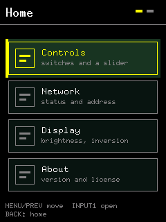
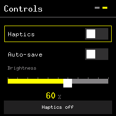

# gui-showcase — a small UI built from the framework's widgets

Two screens on a 240x320 ST7789, wired to SPI1 with four keys.  
Everything the user can see is animated through dirty rectangles: a selection bar slides, a switch knob moves, a slider fill eases, a toast slides up, and a screen change slides sideways.  
When nothing moves, no SPI traffic happens.

| Home | Controls |
|---|---|
|  |  |

## What it demonstrates

- `widget::Highlight` — the card selection bar (repaints the union of the old and new row).
- `widget::Toggle` / `widget::Slider` — animated controls that own their state and report their own dirty rectangles.
- `widget::Toast` — a banner that slides in, holds and slides out.
- A horizontal screen transition with an eased offset, plus a header that crossfades with it.
- `BandBuffers` and the pipelined `ui_task`: paint and transfer overlap.

## Keys

| Key | GPIO | Action |
|---|---|---|
| MENU | GP8 | next row / next control |
| PREV | GP9 | previous row / previous control |
| INPUT 1 | GP1 | open, toggle, or nudge the slider |
| BACK | GP26 | back to home |

## Build and flash

```sh
cargo build -p gui-showcase --release --target thumbv6m-none-eabi
cd examples/gui-showcase
probe-rs run --chip rp2040 --protocol swd --speed 100
```

Panel: SPI1 with MOSI GP11, SCK GP14, CS GP13, DC GP22, RST GP27, BL GP28 — the same wiring as `examples/spi1-panel`.  
`defmt` logs are available over RTT.

The screens can be rendered on the host for review:

```sh
cargo run -p utsuroui-demo --example render_gui   # target/gui/*.png
```
